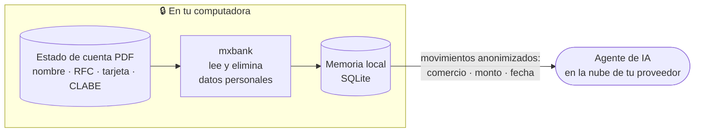
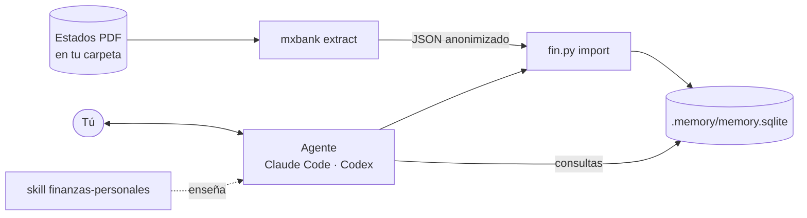

<h1 align="center">finanzas-personales · Tus finanzas sin app, con IA</h1>

<p align="center">
  <b>Importa tus estados de cuenta, categoriza, presupuesta y pregunta, todo en la conversación con tu agente de IA.</b><br>
  Privacidad por diseño · lectura y almacenamiento en tu computadora · código abierto y auditable · Claude Code y Codex
</p>

<p align="center">
  <a href="https://github.com/howware/finanzas-personales/actions/workflows/ci.yml"></a>
  
  <a href="https://howware.org"></a>
  
  
</p>

<p align="center">
  <a href="https://howware.org/finanzas-personales/">Sitio del proyecto</a> ·
  <a href="#instalación">Instalación</a> ·
  <a href="#primeros-pasos">Primeros pasos</a> ·
  <a href="#privacidad-por-diseño">Privacidad por diseño</a> ·
  <a href="README.en.md">English</a>
</p>

> **El primer [howware](https://howware.org).** Un howware es tu saber hacer, puesto a trabajar con IA: dices las
> reglas con tus palabras y un agente las sigue, con unas cuantas herramientas exactas y una memoria tuya. Sin app
> que construir, sin intermediarios, sin esperas. Este repo cumple la
> [especificación howware 0.1](https://github.com/howware/howware/blob/main/docs/es/especificacion.md); su
> manifiesto es [`howware.json`](howware.json).

Una app de finanzas personales es, en el fondo, cuatro cosas: **captura** de movimientos, una **base de datos**,
**reglas** (categorías, presupuestos) y **pantallas**. Con un agente de IA la pantalla es la conversación, y el
resto lo hacen tres herramientas locales y abiertas:

| Pieza de una app | Aquí |
|---|---|
| Captura | [mxbank](https://github.com/howware/mx-bank-statement-reader): lee el PDF del banco en tu máquina y entrega JSON anonimizado |
| Base de datos | [Long-Term Memory for AI](https://github.com/howware/long-term-memory-for-AI): un archivo SQLite local, solo de agregado, con historia |
| Reglas | **este repo**: el skill `finanzas-personales` y `fin.py` |
| Pantallas | la conversación con Claude Code o Codex |

```text
› Importa los estados de estados/septiembre/

3 estados, 142 movimientos nuevos. Todos concilian.
Pendiente: pagar $8,420.15 de BBVA Azul antes del 8 oct.
14 comercios nuevos. Propongo: Alimentación › Súper: WALMART, SORIANA … ¿Los apruebo así?

› Sí. ¿Cómo voy con el presupuesto de súper?

Llevas $3,180.40 de $4,000.00 (79 %). Te quedan $819.60 para 9 días.
```

## Privacidad por diseño

Este proyecto nació de una pregunta: **¿cómo usar IA con tus finanzas sin entregarle tu identidad?** Un estado
de cuenta trae tu nombre, domicilio, RFC, números de tarjeta y CLABE, y los nombres y cuentas de las personas a
las que les transfieres. Subirlo a un chat de IA entrega todo eso a un tercero.

Por eso está construido para que **el estado de cuenta no se le entregue a la IA**: se lee en tu computadora,
los datos que te identifican se eliminan ahí mismo, y el agente trabaja con lo que queda, movimientos sin tu
nombre ni tus cuentas. Abajo está qué hace cada pieza, qué **no** podemos garantizar y dónde está el código
para que lo compruebes.



| 🔒 Diseñado para quedarse en tu computadora | Lo que la IA sí ve, para poder responderte |
|---|---|
| El PDF del estado de cuenta | Comercio, monto y fecha de cada movimiento |
| Tu nombre, domicilio, RFC y CURP | Categorías, presupuestos y totales |
| Números de tarjeta, de cuenta y CLABE | Seudónimos en lugar de cuentas (`ACC_92d5`) y personas (`PERSONA_7f3a`) |
| Nombres y cuentas de las personas a las que transfieres | El nombre del producto y los últimos 4 dígitos de la cuenta (se omiten con `--privacy strict`) |
| Claves de rastreo, referencias y conceptos de transferencias | Lo que tú escribes en la conversación |
| El archivo de la memoria (el agente le hace consultas y ve las respuestas) | |

### Cómo está construido

| Medida | Dónde comprobarlo |
|---|---|
| El skill le prohíbe al agente abrir o leer el PDF; solo `mxbank` lo lee | [SKILL.md](skill/finanzas-personales/SKILL.md#reglas-no-negociables) · [skill de mxbank](https://github.com/howware/mx-bank-statement-reader/blob/main/.claude/skills/mxbank/SKILL.md) |
| La salida de mxbank se arma con una lista cerrada de campos: no hay dónde quepa tu nombre o domicilio | [models/statement.py](https://github.com/howware/mx-bank-statement-reader/blob/main/src/mxbank/models/statement.py) |
| Un escáner revisa el resultado completo (CLABE, tarjeta, RFC, CURP, correo y las palabras de tu nombre y domicilio) y, si sospecha, **no entrega nada** | [privacy/residual_scan.py](https://github.com/howware/mx-bank-statement-reader/blob/main/src/mxbank/privacy/residual_scan.py) · [privacy/detectors.py](https://github.com/howware/mx-bank-statement-reader/blob/main/src/mxbank/privacy/detectors.py) |
| Las personas a las que transfieres se vuelven seudónimos con una llave que solo tú tienes | [privacy/pseudonym.py](https://github.com/howware/mx-bank-statement-reader/blob/main/src/mxbank/privacy/pseudonym.py) |
| mxbank, `fin.py` y la memoria no abren conexiones de red; las pruebas de mxbank fallan si algo lo intenta | [tests/conftest.py](https://github.com/howware/mx-bank-statement-reader/blob/main/tests/conftest.py) · [fin.py](skill/finanzas-personales/scripts/fin.py) · [memoria](https://github.com/howware/long-term-memory-for-AI#tus-datos) |
| Todo se guarda en un archivo SQLite de tu carpeta: sin servidor ni cuenta | [Long-Term Memory for AI](https://github.com/howware/long-term-memory-for-AI) |
| Este repositorio rechaza en CI PDFs, bases de datos e identificadores personales | [tools/check_private_data.py](tools/check_private_data.py) |

### Lo que no podemos garantizar

- **La anonimización automática no es infalible.** Un formato nuevo del banco, un concepto escrito a mano o un
  error de software podrían dejar pasar un dato. mxbank prefiere no entregar nada ante la duda, pero si vas a
  compartir una salida, revísala (`mxbank audit` ayuda).
- **La regla de no abrir el PDF es una instrucción al agente.** Los agentes la siguen, pero no es una barrera
  física. En Claude Code puedes reforzarla con un permiso que le niega leer PDFs (ver
  [Primeros pasos](#primeros-pasos)); aun así, un agente con acceso a la terminal tendría otras formas de leer
  un archivo.
- **Lo que el agente sí ve sale de tu computadora.** Comercios, montos, fechas, seudónimos y tus mensajes llegan
  a tu proveedor de IA y quedan sujetos a sus términos. No te identifican por sí solos, pero son información
  sobre tus hábitos de gasto.
- **La memoria no está cifrada.** Protégela como cualquier archivo personal (cifrado de disco, respaldos).

### Código abierto para que lo revises

No te pedimos confianza: te pedimos que lo revises. Las tres piezas son **código abierto bajo Apache 2.0** y
son pequeñas a propósito. `fin.py` son unas 600 líneas de Python sin dependencias, y el protocolo del agente es
un archivo de texto que puedes leer en cinco minutos.

- [finanzas-personales](https://github.com/howware/finanzas-personales) · [mxbank](https://github.com/howware/mx-bank-statement-reader) · [Long-Term Memory for AI](https://github.com/howware/long-term-memory-for-AI)
- Si encuentras una forma en que un dato personal llegue a la IA, o cualquier otro problema de privacidad,
  repórtalo de forma privada siguiendo [SECURITY.md](SECURITY.md). Tiene prioridad sobre cualquier otro cambio.

---

## Contenido

- [Privacidad por diseño](#privacidad-por-diseño)
  - [Cómo está construido](#cómo-está-construido) · [Lo que no podemos garantizar](#lo-que-no-podemos-garantizar) · [Código abierto para que lo revises](#código-abierto-para-que-lo-revises)
- [Características](#características)
- [Cómo funciona](#cómo-funciona)
- [Instalación](#instalación)
- [Primeros pasos](#primeros-pasos)
- [Qué le puedes pedir](#qué-le-puedes-pedir)
- [Categorías](#categorías)
- [Privacidad](#privacidad)
- [Referencia de fin.py](#referencia-de-finpy)
- [Limitaciones](#limitaciones)
- [Desarrollo](#desarrollo)
- [Documentación](#documentación)
- [Hoja de ruta](#hoja-de-ruta)
- [Licencia](#licencia)

## Características

- **Diseñado para que tus datos personales no lleguen a la IA.** El estado de cuenta se lee y se anonimiza en
  tu computadora; el agente trabaja con movimientos sin tu nombre ni tus cuentas. Ver
  [Privacidad por diseño](#privacidad-por-diseño).
- **Código abierto y auditable.** Las tres piezas son Apache 2.0 y pequeñas, para que cualquiera las revise.
- **Importa estados de cuenta** de BBVA (débito y crédito) y BanCoppel (débito). Reimportar o importar en
  desorden no duplica nada: cada movimiento tiene un id estable.
- **Categorías que aprenden.** Corriges un comercio una vez y todo su historial se reclasifica. Las
  excepciones de un solo movimiento («eso fue un regalo») no rompen la regla.
- **Efectivo en una frase.** «Ayer gasté 180 en la fonda» queda registrado con tus palabras como evidencia.
- **Presupuestos con historia.** Por categoría o subcategoría y por mes; el presupuesto de enero sigue siendo
  el de enero aunque lo cambies después.
- **Pagos de tarjeta.** Cada sesión empieza recordándote el pago para no generar intereses y la fecha límite;
  el pendiente se cierra solo cuando el siguiente estado trae el pago.
- **Reportes al momento.** Gasto por categoría, mes contra mes, meses sin intereses vigentes, intereses y
  comisiones pagados, cargos sin categoría.
- **Nada se borra.** La memoria es solo de agregado: los cambios cierran o anulan, con autor, fecha y motivo.
- **Sin dependencias.** `fin.py` usa solo la biblioteca estándar de Python.

## Cómo funciona



1. `mxbank` lee el PDF localmente, concilia las cifras y elimina nombre, RFC, tarjeta, CLABE y datos de terceros.
2. `fin.py import` guarda cuentas, movimientos, saldos, compras a meses y pagos pendientes en la memoria.
3. Cada movimiento apunta a su comercio, contraparte o tipo; la **regla de categoría vive ahí**, no en el
   movimiento, por eso corregirla corrige todo el historial sin reescribir nada.
4. El agente sigue el protocolo de [`SKILL.md`](skill/finanzas-personales/SKILL.md): propone categorías, te
   pregunta lo que no sabe y responde con consultas a la memoria.

## Instalación

Requiere Python 3.9+ y, para mxbank, Python 3.12+ con [uv](https://docs.astral.sh/uv/).

```bash
# 1. mxbank (captura)
git clone https://github.com/howware/mx-bank-statement-reader
cd mx-bank-statement-reader && uv tool install . && cd ..

# 2. Memoria persistente (almacén)
git clone https://github.com/howware/long-term-memory-for-AI
python long-term-memory-for-AI/tools/install_skill.py --target ~/.claude/skills/project-memory

# 3. Este skill (reglas)
git clone https://github.com/howware/finanzas-personales
python finanzas-personales/tools/install_skill.py
```

Para Codex, usa `--target ~/.codex/skills/<nombre>` en los pasos 2 y 3. Instala también el skill
[`mxbank`](https://github.com/howware/mx-bank-statement-reader#skill-para-claude-code) para que el agente sepa
usarlo.

**Llave de seudónimos.** Define una vez la variable de entorno `MXBANK_KEY` con un valor aleatorio largo y
**respáldala** en tu gestor de contraseñas. Mantiene estables los ids y seudónimos entre meses; si la cambias,
los movimientos se importarían de nuevo.

```powershell
# Windows (PowerShell): la genera y la guarda sin mostrarla
$b = New-Object byte[] 48; [Security.Cryptography.RandomNumberGenerator]::Create().GetBytes($b); [Environment]::SetEnvironmentVariable('MXBANK_KEY', [Convert]::ToBase64String($b), 'User')
```

```bash
# macOS / Linux: agrégala a tu perfil de shell
echo "export MXBANK_KEY='$(python3 -c 'import secrets; print(secrets.token_urlsafe(48))')'" >> ~/.zshrc
```

## Primeros pasos

1. Crea una carpeta para tus finanzas (por ejemplo `~/mis-finanzas`) y pon tus PDF en `estados/`.
2. Agrega un `CLAUDE.md` (o `AGENTS.md` para Codex) con la instrucción de memoria persistente de
   [Long-Term Memory for AI](https://github.com/howware/long-term-memory-for-AI#configurar-un-proyecto) y, si
   usas git, un `.gitignore` con `estados/`, `reportes/` y `.memory/`.
3. *(Recomendado en Claude Code)* refuerza la regla de no leer PDFs con un permiso en
   `.claude/settings.json` de esa carpeta. Bloquea la herramienta de lectura de archivos, no los comandos de
   terminal, así que reduce el riesgo pero no lo elimina:

   ```json
   { "permissions": { "deny": ["Read(**/*.pdf)"] } }
   ```

4. Abre ahí Claude Code o Codex y escribe: *«Quiero llevar mis finanzas aquí.»* El agente te pide tu nombre,
   crea la memoria y carga las categorías.
5. *«Importa los estados de `estados/`.»* Revisa y aprueba la propuesta de categorías.

## Qué le puedes pedir

| Quieres | Dile |
|---|---|
| Importar | «Importa los estados de octubre» |
| Capturar efectivo | «Ayer gasté 180 en efectivo en la fonda» |
| Corregir una categoría | «OXXO es súper, no conveniencia» · «Lo de Amazon del 18 fue un regalo» |
| Presupuestar | «Pon 4,000 al mes para súper desde noviembre» |
| Saber cómo vas | «¿Cuánto gasté en septiembre?» · «¿Cómo voy con el presupuesto?» |
| Pagos | «¿Qué tarjetas tengo que pagar y cuándo?» · «¿Cuánto pagué de intereses este año?» |
| Revisar | «¿Qué suscripciones tengo?» · «¿Qué compras a meses me faltan?» |
| Cerrar el mes | «Hagamos el cierre de septiembre» |

## Categorías

Doce categorías principales fijas, para poder comparar meses: Vivienda, Alimentación, Transporte, Salud,
Educación, Entretenimiento, Suscripciones, Compras personales, Costos financieros, Ingresos, Otros y
Movimientos internos. Las **subcategorías y las reglas por comercio se crean conforme importas**: el agente
las propone y tú las apruebas.

**Movimientos internos** (pago a tu tarjeta, traspasos entre tus cuentas, retiros, traslados a meses) se
excluyen de los reportes: no son gasto. El gasto del efectivo retirado se captura aparte.

## Privacidad

Detalle de cada dato. El resumen está en [Privacidad por diseño](#privacidad-por-diseño).

| Dato | Tratamiento |
|---|---|
| El PDF | El skill le prohíbe al agente leerlo; solo `mxbank` lo lee, en tu máquina (refuérzalo con el permiso de [Primeros pasos](#primeros-pasos)) |
| Nombre, domicilio, RFC, CURP, tarjeta, CLABE | Los elimina `mxbank` antes de que nada más los vea |
| Personas a las que transfieres | Seudónimos estables (`PERSONA_7f3a`); tú les pones nombre si quieres |
| Comercio, monto y fecha | Se guardan: es el propósito de la herramienta |
| La memoria | Un archivo SQLite en tu carpeta: sin servidor, sin cuenta, fuera de git |
| Reportes | En la conversación o en una carpeta local; nada se publica sin que lo pidas |
| Lo que tú escribes | Llega a la IA como cualquier mensaje. Si a un seudónimo le pones nombre («PERSONA_7f3a es mi casero»), ese nombre también. No escribas números de cuenta ni contraseñas |

La memoria no está cifrada: protégela como cualquier archivo personal (cifrado de disco, respaldos con
`memory.py backup`). Este repo tiene una guardia en CI que impide versionar PDFs, bases de datos, CLABEs,
tarjetas, RFC, CURP o correos.

## Referencia de fin.py

El agente lo usa por ti; esta tabla es para auditar o automatizar. Toda salida es JSON.

| Comando | Hace |
|---|---|
| `setup --by person:<id>` | Carga predicados, categorías, reglas por tipo de movimiento y recetas en la memoria |
| `import ARCHIVO… --by …` | Importa JSON o NDJSON de mxbank (rechaza los generados sin llave) |
| `categorize --rule merchant:x=category:grupo/sub …` | Guarda reglas comercio, contraparte o tipo → subcategoría |
| `add-category --key category:grupo/sub --name …` | Crea una subcategoría |
| `recategorize TX_… --to category:…` | Cambia la categoría de un solo movimiento |
| `expense --amount 180 --description "…"` | Captura un gasto (o `--income`) en efectivo u otra cuenta |
| `budget --category … --amount 4000 --month 2026-11` | Fija el presupuesto mensual desde ese mes |
| `report --month 2026-09 [--level sub]` | Ingresos, gasto y neto por categoría, con presupuesto |

Errores: `{"ok": false, "error": {"code": …, "message": …}}` con código de salida **2** (entrada inválida) o
**3** (problema con la memoria). Montos en la memoria: enteros en centavos (`MXN_cent`). Requiere mxbank ≥ 0.2.0 y Long-Term Memory for AI
≥ 0.3.0; `fin.py` verifica la versión de la memoria.

## Limitaciones

- **Bancos:** los que soporta mxbank (BBVA débito y crédito, BanCoppel débito). Otros bancos se agregan en mxbank.
- **Solo MXN.** Las compras en otra moneda llegan convertidas por el banco.
- **Compras pasadas a meses después de hechas** («ALTA PARA MESES»): la compra y sus parcialidades contarían
  doble; el agente lo detecta y te propone corregirlo.
- **Comercios no reconocidos por mxbank** se nombran con las dos primeras palabras útiles de la descripción;
  dos variantes del mismo comercio pueden quedar como dos entradas con la misma categoría.
- **Una computadora.** Sin sincronización entre equipos ni personas.

Detalle y decisiones de diseño en [docs/02-diseno.md](docs/02-diseno.md).

## Desarrollo

```bash
git clone https://github.com/howware/long-term-memory-for-AI ../long-term-memory-for-AI
python -m unittest discover -s tests -v
git ls-files -z | xargs -0 python tools/check_private_data.py
```

Las pruebas usan una memoria temporal y JSON que mxbank genera a partir de sus **PDFs sintéticos**. Buscan el
helper de la memoria en `FIN_MEMORY_HELPER`, en `../long-term-memory-for-AI/db/memory.py` o en el skill
instalado. **Nunca agregues estados de cuenta reales ni su JSON**: la guardia de CI los rechaza. Reglas para
quien desarrolle con IA: [AGENTS.md](AGENTS.md).

```
skill/finanzas-personales/
  SKILL.md            protocolo que sigue el agente
  scripts/fin.py      importador, reglas, capturas y reportes
  scripts/seed.json   predicados, categorías, reglas por tipo y recetas
tools/                instalador del skill y guardia de datos privados
tests/                pruebas y fixtures sintéticos
docs/                 análisis y diseño
site/                 sitio del proyecto (GitHub Pages)
```

## Documentación

| Documento | Contenido |
|---|---|
| [01 · Análisis](docs/01-analisis.md) | Qué hace una app de finanzas personales y cómo se cubre sin app |
| [02 · Diseño](docs/02-diseno.md) | Decisiones, modelo en la memoria, limitaciones conocidas |
| [SKILL.md](skill/finanzas-personales/SKILL.md) | El protocolo del agente |
| [CHANGELOG](CHANGELOG.md) | Historial de versiones |
| [Aviso legal](AVISO-LEGAL.md) · [Seguridad](SECURITY.md) | Límites de responsabilidad y reporte privado de problemas |

## Hoja de ruta

- Metas de ahorro, deudas (avalancha / bola de nieve) y patrimonio neto.
- Detección de cargos recurrentes y aumentos de precio entre meses.
- Tablero HTML local regenerable desde la memoria.
- Gastos compartidos y deducibles personales con CFDI.
- Más bancos, conforme mxbank los soporte.

## Licencia

[Apache 2.0](LICENSE): se distribuye tal cual, sin garantías. Herramienta de organización personal; **no es
asesoría financiera, fiscal ni legal**. No está afiliado ni respaldado por BBVA México, BanCoppel ni ninguna
institución financiera. Lee el [aviso legal](AVISO-LEGAL.md).
