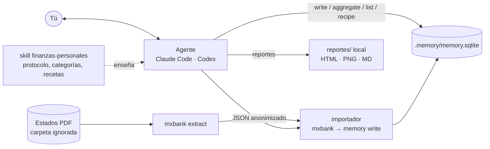

# 01 · Análisis: finanzas personales sin app

## 1. Tesis

Una app de finanzas personales es, en esencia, cuatro cosas: **captura** de movimientos, un **almacén** histórico, **reglas** (categorías, presupuestos, metas) y **vistas** (reportes, alertas). Las apps existen porque, hasta ahora, la única forma de unir esas piezas era una interfaz programada.

Con un agente de IA (Claude Code o Codex) la interfaz es la conversación, y las piezas se reducen a herramientas locales que el agente invoca:

| Pieza de una app | En este proyecto |
|---|---|
| Captura (importar banco, capturar efectivo) | `mxbank` (PDF → JSON anonimizado) + la conversación |
| Base de datos | `long-term-memory-for-AI` (SQLite local, solo de agregado) |
| Lógica de negocio (categorías, presupuestos, metas) | Un **skill** de finanzas + reglas y recetas guardadas en la memoria |
| Pantallas y reportes | Respuestas del agente, tablas y gráficas en archivos locales |

Objetivo de la demo: que una persona lleve sus finanzas un mes completo —importar, categorizar, presupuestar, pagar a tiempo, revisar— **sin abrir ninguna app**, solo hablando con el agente.

## 2. Qué hace una herramienta de finanzas personales

Capacidades típicas (YNAB, Monarch, Copilot, Fintonic, Mobills, Money Lover, hojas de cálculo), agrupadas y priorizadas para la demo:

| # | Capacidad | Descripción | Prioridad |
|---|---|---|---|
| C1 | Cuentas | Débito, crédito, efectivo, ahorro, inversión, préstamos; saldo actual de cada una | MVP |
| C2 | Importar movimientos | Desde el banco (aquí: estado de cuenta PDF), sin duplicar al reimportar | MVP |
| C3 | Captura manual | Efectivo, gastos que no pasan por el banco ("gasté 120 en tacos") | MVP |
| C4 | Categorización | Categoría por movimiento; reglas por comercio que se aprenden ("OXXO = Conveniencia") | MVP |
| C5 | Transferencias internas | Pago a tarjeta, traspasos entre cuentas propias: no son gasto ni ingreso | MVP |
| C6 | Flujo de efectivo | Ingresos vs. gastos por mes, por categoría, tendencia | MVP |
| C7 | Presupuesto | Monto por categoría y mes; cuánto queda; alertas de exceso | MVP |
| C8 | Tarjetas de crédito | Fecha de corte, fecha límite, pago para no generar intereses, intereses pagados, MSI pendientes | MVP |
| C9 | Recurrentes y suscripciones | Detectar cargos fijos, aumentos de precio, duplicados | MVP |
| C10 | Calendario de pagos | Qué vence esta semana (tarjetas, renta, servicios, préstamos) | MVP |
| C11 | Metas de ahorro | Fondo de emergencia, viaje, enganche; avance y aportación sugerida | Fase 2 |
| C12 | Deudas | Saldo, tasa, plan de pago (avalancha / bola de nieve), proyección de liquidación | Fase 2 |
| C13 | Patrimonio neto | Activos − pasivos en el tiempo; inversiones (CETES, Afore, fondos) con valuación manual | Fase 2 |
| C14 | Reportes visuales | Gráficas por categoría, mes contra mes, tablero | Fase 2 |
| C15 | Cierre de mes | Rutina guiada: importar, revisar sin categoría, comparar con presupuesto, notas | Fase 2 |
| C16 | Gastos compartidos | Quién debe a quién (pareja, roomies) | Fase 3 |
| C17 | Impuestos (MX) | Deducciones personales (médicos, colegiaturas, intereses hipotecarios) con su CFDI | Fase 3 |
| C18 | Proyecciones | "Si sigo así, ¿cuánto tendré en diciembre?" | Fase 3 |
| C19 | Multi-moneda | Compras en USD, cuentas en otra moneda | Fase 3 |
| C20 | Privacidad y respaldo | Datos locales, respaldo verificable, nada publicado sin permiso | Transversal |

Lo que una app hace y aquí **no se necesita**: pantallas, login, sincronización en la nube, notificaciones push (se reemplazan por la rutina de inicio de sesión del agente y, si se quiere, una tarea programada).

## 3. Qué cubre cada herramienta hoy

### mxbank (captura)

- Lee PDF de BBVA débito, BBVA crédito y BanCoppel débito, localmente.
- Entrega movimientos con `type` técnico (23 tipos: `card_purchase`, `card_payment`, `spei_out`, `installment`…), `merchant` canónico, montos decimales y fechas ISO.
- Tarjeta de crédito completa: corte, fecha límite, pago mínimo y sin intereses, CAT, intereses, comisiones, planes a meses.
- Concilia contra los saldos y totales del banco; elimina PII; seudónimos estables entre meses con llave.
- **No** asigna categoría semántica (decisión explícita: la hace la IA), no consolida meses, no tiene id estable por movimiento.

### long-term-memory-for-AI (almacén)

- SQLite local, solo de agregado, con historia (`--as-of`), evidencia y actor por registro.
- Modelo genérico: entidades (cuentas, categorías, comercios, metas), hechos con vigencia (presupuesto de una categoría desde una fecha), eventos con atributos y enlaces (movimientos).
- Consultas sin SQL: `aggregate` (sumas por mes, por categoría), `list`, reglas de estado, **recetas** guardadas con parámetros.
- `write` atómico e idempotente: reenviar el mismo documento no duplica.
- `brief` al iniciar sesión: pendientes, decisiones, lo reciente.

### Mapa de cobertura

| Capacidad | mxbank | Memoria | Agente / skill | Falta |
|---|---|---|---|---|
| C1 Cuentas | `account_ref`, saldos | entidades `account` + hecho `balance` | — | Cuentas sin estado (efectivo, inversiones) se crean a mano |
| C2 Importar | ✅ | ✅ eventos idempotentes | orquesta | **Adaptador mxbank → memoria**; id estable por movimiento |
| C3 Manual | — | ✅ `write` | interpreta el lenguaje natural | Reglas del skill para capturar bien |
| C4 Categorías | `merchant`, `type` | entidades `category` + hecho `categorized_as` por comercio | clasifica | Catálogo base de categorías y comercios MX |
| C5 Transferencias | `type` (card_payment, transfer_internal) | enlace entre los dos movimientos | empareja | Regla de emparejamiento débito↔crédito |
| C6 Flujo | — | `aggregate --by period:month` | presenta | Recetas predefinidas |
| C7 Presupuesto | — | hecho `budget_amount` con vigencia | compara | Receta "presupuesto vs. real" (cruza hecho y suma) |
| C8 Tarjetas | ✅ | eventos `statement_imported` con atributos | alerta | — |
| C9 Recurrentes | — (en hoja de ruta) | consultas por comercio y mes | detecta | Lógica en el skill o en mxbank `--consolidate` |
| C10 Calendario | fecha límite | eventos con `pending_for` | `pending` / `brief` | Recurrencias que no vienen en un estado (renta) |
| C11–C13 | — | entidades + hechos | calcula | Solo convenciones en el skill |
| C14 Gráficas | — | — | genera HTML/PNG local | Plantilla de tablero |

## 4. Arquitectura propuesta

Tres piezas nuevas, todas pequeñas:

1. **Importador** (`importar.py`, o subcomando en mxbank): convierte el JSON de mxbank en un documento `memory write` determinista. Así el agente no "traduce" 300 movimientos a mano (caro, propenso a errores) y reimportar no duplica.
2. **Skill `finanzas-personales`**: el protocolo. Cómo importar, cómo categorizar, qué no es gasto, cómo capturar efectivo, rutina de inicio y de cierre de mes, cómo presentar. Se apoya en los skills `mxbank` y `project-memory`.
3. **Semilla del dominio** (`seed.json`): predicados, catálogo de categorías, reglas de estado y recetas, cargado una vez en una memoria nueva.

Todo vive en una carpeta de proyecto por persona (p. ej. `~/mis-finanzas/`), con `estados/`, `reportes/` y `.memory/` fuera de git.

## 5. Modelo de datos en la memoria (borrador)

Todo en inglés, como pide la memoria.

**Entidades**

| Tipo | Clave | Ejemplo |
|---|---|---|
| `account` | `account:<account_ref>` o `account:cash` | `account:ACC_92d5` "BBVA Azul crédito" |
| `category` | `category:<slug>` (con `part_of` para subcategorías) | `category:food/restaurants` |
| `merchant` | `merchant:<slug>` | `merchant:oxxo` |
| `counterparty` | `counterparty:<seudónimo>` | `counterparty:PERSONA_7f3a` "Casero" (alias que pone el usuario) |
| `goal` | `goal:<slug>` | `goal:emergency-fund` |
| `installment_plan` | `plan:<hash>` | compra a MSI |

**Hechos (con vigencia)**: `account_kind`, `bank`, `credit_limit`, `budget_amount` (sobre `category`, `valid_from` = mes), `categorized_as` (merchant → category, la regla aprendida), `goal_target`, `goal_due`.

**Eventos**

| Tipo | Atributos clave | Enlaces |
|---|---|---|
| `transaction` | `amount_cents` (entero), `tx_type`, `description`, `source` (`statement`/`manual`) | `on_account`, `at_merchant`, `in_category`, `with_counterparty`, `imported_from` |
| `statement_imported` | periodo, saldos, `reconciled`, `no_interest_payment_cents`, `payment_due_date` | `on_account` |
| `transfer_matched` | — | los dos `transaction` |
| `payment_due` | `amount_cents`, `due_date`; `pending_for: person:…` | `on_account`; se resuelve con el `transaction` del pago |
| `goal_contribution` | `amount_cents` | `toward_goal` |

**Clave del evento** (para idempotencia): `tx:<account_ref>:<fecha>:<hash(descripción, monto, índice en el estado)>`.

**Recetas iniciales**: `recipe:monthly-cashflow`, `recipe:spend-by-category`, `recipe:budget-vs-actual`, `recipe:uncategorized`, `recipe:upcoming-payments`, `recipe:merchant-history`.

## 6. Mejoras necesarias a las herramientas

### mxbank

| # | Mejora | Por qué |
|---|---|---|
| M1 | **`id` estable por movimiento** (hash de cuenta, fecha, descripción normalizada, monto y ocurrencia) | Reimportar o importar estados traslapados sin duplicar |
| M2 | Salida directa para la memoria (`mxbank export --format memory`) o el importador como paquete aparte | Evita que el agente transcriba movimientos |
| M3 | `--consolidate` multi-mes y detección de recurrentes (ya en su hoja de ruta) | C9 |
| M4 | Más bancos: Nu, Banorte, Santander, Amex, Mercado Pago, Hey Banco; y formatos alternos (CSV/OFX de banca en línea) | Una persona típica tiene 2–4 instituciones |
| M5 | Decidir la pregunta abierta B (`category`): **recomiendo no** agregarla en mxbank; la categoría vive en la memoria como regla del usuario | Mantiene mxbank enfocado y la categoría es preferencia personal |
| M6 | Lectura de CFDI (XML) de facturas | C17 deducibles |

### long-term-memory-for-AI

| # | Mejora | Por qué |
|---|---|---|
| L1 | **Tipo decimal / monetario** (o documentar el patrón de centavos enteros) | Hoy solo hay `real`; sumar flotantes en dinero produce errores de centavos |
| L2 | Excluir tipos de evento del `brief` "Most recent" (p. ej. `transaction`) | Una importación de 300 movimientos tapa decisiones y pendientes |
| L3 | Escritura masiva eficiente (`write` con miles de eventos) y medir rendimiento de `aggregate` con ~10k eventos/año | Volumen realista: 2–5 años de movimientos |
| L4 | Aritmética en recetas (real − presupuesto, porcentaje) o `aggregate` que cruce un hecho con una suma | C7 sin que el agente calcule a mano |
| L5 | Recurrencias en `pending` (renta cada día 1) | C10 |
| L6 | Nota de seguridad: sin cifrado → recomendar cifrado de disco; datos financieros propios sí pueden quedar en una memoria solo de agregado | C20 |

### Nuevo

| # | Pieza | Contenido |
|---|---|---|
| N1 | Skill `finanzas-personales` | Protocolo de captura, categorización, reglas "qué no es gasto", rutinas de inicio y cierre, formato de respuestas |
| N2 | Importador | JSON mxbank → documento `write` con claves estables, enlaces a cuenta/comercio/categoría por regla |
| N3 | Semilla | Predicados, catálogo de categorías MX, recetas y reglas de estado |
| N4 | Plantilla de tablero | HTML local autocontenido generado desde `aggregate` (opcional) |

## 7. Flujos de la demo

1. **Arranque**: "Quiero llevar mis finanzas aquí." → `init` de memoria, carga de semilla, alta de cuentas.
2. **Importar**: "Importa los estados de `estados/2026-09/`." → mxbank → importador → resumen: N movimientos, conciliados, M sin categoría.
3. **Categorizar**: el agente propone categorías para comercios nuevos; el usuario corrige una vez y queda como regla.
4. **Capturar**: "Ayer gasté 180 en efectivo en la fonda." → `transaction` en `account:cash`.
5. **Preguntar**: "¿Cuánto gasté en restaurantes este mes vs. el pasado?", "¿Qué suscripciones tengo?", "¿Cuánto pagué de intereses este año?"
6. **Presupuestar**: "Pon 4,000 al mes para súper." → hecho con vigencia; "¿Cómo voy?" → receta.
7. **Pagos**: al iniciar sesión el `brief` muestra "Pagar BBVA Azul $1,965 antes del 8 de octubre".
8. **Cierre de mes**: rutina guiada y reporte local.

## 8. Privacidad y límites

- Los PDF nunca los lee el agente; solo mxbank (regla del skill mxbank).
- La memoria guarda montos, fechas, comercios y seudónimos; nunca nombres, CLABE ni tarjetas.
- Todo local; reportes en carpeta ignorada; nada se publica sin permiso explícito.
- El agente **informa y organiza**; no es asesor financiero ni ejecuta pagos o transferencias.

## 9. Fases

| Fase | Entrega | Demuestra |
|---|---|---|
| 0 | Este análisis + decisiones | — |
| 1 · MVP | Semilla, importador, skill v1, M1, L1 (patrón centavos), L2 | Importar 3 meses, categorizar, flujo mensual, presupuesto, pagos de tarjeta |
| 2 | Recurrentes (M3), metas, deudas, patrimonio, tablero HTML, cierre de mes | Un mes completo sin app |
| 3 | Más bancos (M4), CFDI/deducibles, gastos compartidos, proyecciones | Uso real sostenido |

## 10. Preguntas abiertas

P1–P3 ya están decididas; ver [02-diseno.md §1](02-diseno.md#1-decisiones).

| # | Pregunta | Estado |
|---|---|---|
| P1 | ¿El importador vive en mxbank (`export --format memory`), en este repo, o como skill autocontenido? | Decidida: en este repo, como skill (D4) |
| P2 | Montos: ¿centavos enteros en la memoria ahora, o agregar tipo `decimal` a la memoria primero? | Decidida: centavos enteros (D3) |
| P3 | ¿Catálogo de categorías propio o uno estándar (p. ej. el de INEGI/ENIGH adaptado)? | Decidida: 12 principales fijas + subcategorías dinámicas (D5) |
| P4 | ¿Una memoria por persona/hogar? ¿Se contemplan finanzas de pareja (C16) desde el diseño? |
| P5 | ¿Reportes solo en conversación y archivos locales, o también un tablero HTML local regenerable? |
| P6 | ¿Codex es objetivo de primer nivel en la demo (sin hooks: el arranque depende de `AGENTS.md`)? |
