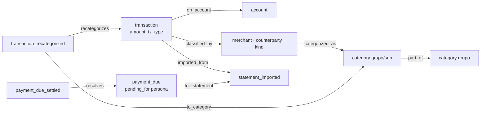

# 02 · Diseño del MVP

Implementa la fase 1 de [01-analisis.md](01-analisis.md) con las decisiones tomadas hasta ahora.

## 1. Decisiones

| # | Decisión | Motivo |
|---|---|---|
| D1 | `mxbank` 0.2.0 emite ids estables con HMAC (`statement_id`, `transactions[].id`, `installment_plans[].id`) | Reimportar sin duplicar; seguir compras a meses entre estados |
| D2 | La memoria 0.2.0 declara `transaction` como tipo de alto volumen | El resumen de inicio no se llena de movimientos |
| D3 | Dinero en **centavos enteros** (`MXN_cent`) | La memoria no tiene decimal; `real` produce errores de centavos |
| D4 | El importador y el skill viven en **este repo** (`skill/finanzas-personales/`) | mxbank no sabe de la memoria y la memoria no sabe de finanzas |
| D5 | Categorías: **12 principales fijas**, subcategorías y reglas **dinámicas**, aprobadas por el usuario | Comparabilidad entre meses sin imponer un catálogo ajeno |
| D6 | La categoría vive en el **clasificador** (comercio, contraparte o tipo), no en el movimiento | Recategorizar un comercio corrige todo su historial sin reescribir eventos (memoria solo de agregado) |
| D7 | Excepciones por movimiento con un evento `transaction_recategorized`; la anterior se anula | Casos raros ("fue un regalo"); auditables |
| D8 | Fechas guardadas a mediodía en la zona local | Una fecha a las 00:00 cambia de día al mostrarse en otra zona |
| D9 | Requiere la memoria 0.3.0: categoría = `first(excepción | regla)`; enlaces de un solo valor (`cardinality: one`) | En `--where`, `first()` exige rutas de un solo valor; así reportes y recetas resuelven todo en una consulta |

## 2. Piezas

```text
skill/finanzas-personales/
  SKILL.md            protocolo para el agente (Claude Code o Codex)
  scripts/fin.py      CLI: setup, import, categorize, add-category, recategorize, expense, budget, report
  scripts/seed.json   predicados, categorías, reglas por tipo y recetas
tests/
  test_fin.py         pruebas contra una memoria real
  fixtures/           JSON de mxbank generados de sus PDFs sintéticos (datos ficticios)
```

`fin.py` usa solo la biblioteca estándar y habla con la memoria a través de su helper (`memory.py`), nunca con
SQL. Busca el helper en `--mem`, `FIN_MEMORY_HELPER` o el skill `project-memory` instalado.

## 3. Modelo en la memoria



| Tipo | Clave | Notas |
|---|---|---|
| `account` | `account:<ACC_…>`, `account:cash` | Hechos: `account_product`, `bank_code`, `balance` y `credit_limit` con vigencia |
| `transaction` | `TX_…` (mxbank), `MAN_…` (captura manual) | `amount` en centavos, negativo = salida |
| `statement_imported` | `ST_…` | Periodo, saldos, datos de tarjeta, `reconciled` |
| `payment_due` / `payment_due_settled` | `DUE_ST_…` / `PAID_ST_…` | Pendiente para la persona hasta que un pago lo resuelve |
| `installment_plan` | `plan:PLAN_…` | `pending_balance` e `installments_paid` con vigencia |
| `category` | `category:<grupo>[/<sub>]` | Nombres en inglés con alias en español |
| clasificadores | `merchant:<slug>`, `counterparty:<seudónimo>`, `kind:<tx_type>` | Regla `categorized_as` (una, con vigencia) |

**Clasificador de cada movimiento** (en orden): tipo con regla fija (pago a tarjeta, retiro, comisión,
nómina…) → contraparte seudonimizada → tipo de transferencia sin contraparte → comercio (`merchant` de
mxbank o las dos primeras palabras útiles de la descripción).

**Pagos de tarjeta:** cada estado de crédito crea `payment_due`. Al importar el estado siguiente (antes o
después, el orden no importa) se suman sus `card_payment` hechos hasta la fecha límite y se registra
`payment_due_settled` con `covered` y `shortfall`.

## 4. Verificado

- Pruebas: importación idempotente, orden indistinto, rechazo de JSON sin llave o con esquema 1.0, NDJSON,
  reglas, excepciones reemplazables, captura manual idempotente, presupuesto por subcategoría sumado a su
  principal y aplicado solo desde su mes, exclusión de movimientos internos.
- Rendimiento de la memoria con 50 000 movimientos: escritura de 500 en 0.83 s, suma por mes y categoría en
  0.65 s, resumen de inicio en 0.07 s.

## 5. Limitaciones conocidas y mejoras pendientes

Resueltas en la memoria 0.3.0: `--as-of` sobre hechos y entidades, "primer valor no vacío" (`first(...)`),
medidas a través de rutas, fechas lejanas en `--as-of` en Windows, `first()` revisado fila por fila como `--by`
y una sola definición de "vigente" también en las lecturas de captura. Los reportes y las recetas ya incluyen
las excepciones en una sola consulta.

| # | Dónde | Qué | Mientras tanto |
|---|---|---|---|
| G4 | mxbank | Compras convertidas a meses después de hechas: la compra y sus parcialidades contarían doble | El skill avisa y propone recategorizar la compra original a `internal/installment-conversion` |
| G5 | fin.py | El nombre de comercio sin `merchant` de mxbank es heurístico (dos palabras) | Se corrige con reglas; dos claves del mismo comercio pueden compartir categoría |
| G6 | fin.py | Solo MXN | Las compras en otra moneda ya vienen convertidas por el banco |
